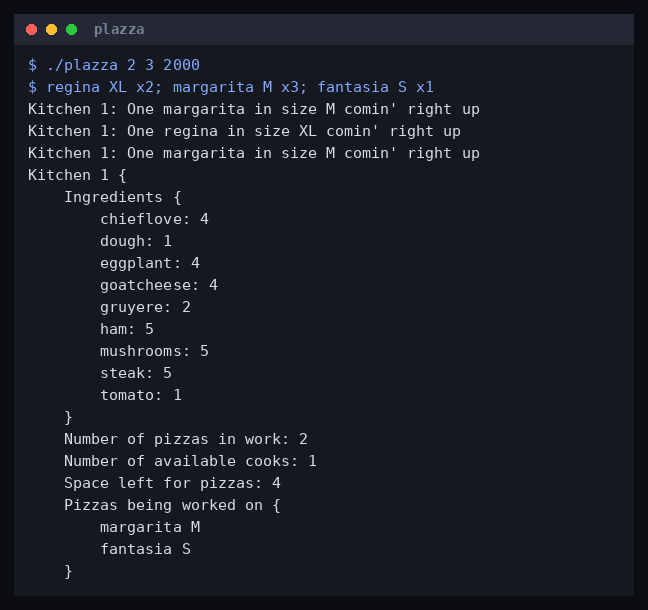

<div align="center">

# The Plazza

**A pizzeria simulation: a reception, kitchens as processes, and cooks as threads.**

  

<sub>Team of 3 · May 2024</sub>

</div>

<p align="center"></p>


## About the project

You type orders like `regina XL x2; margarita M x3` in a shell at the reception. The reception sends each pizza to a **kitchen**. Every kitchen is its own **process**, forked on demand, which talks to the reception through **System V message queues**, closes itself when idle, and runs a pool of **cooks (threads)**. The stock of ingredients is shared inside a kitchen and refilled over time. The `status` command prints what every kitchen is doing.

## Build and run

```bash
make
./plazza <multiplier> <cooks_per_kitchen> <restock_ms>
./plazza 2 3 2000
```

The menu and cooking times are read from [`plazzaMenu.cfg`](plazzaMenu.cfg).

## My contribution

13 of the project's 38 commits (about 750 lines added).

- **Kitchen and pizzas**: the kitchen that cooks pizzas and reports when they are ready, and the pizza classes
- **Concurrency**: the thread pool of cooks and the refilling of the stock
- **Processes**: fixes to the logic of the inter-process communication between the reception and the kitchens
- **Reception**: argument handling, the start of the shell, and the `status` display

## Team

Mathis Brehm, Yanis Harkouk, Eva Legrand.
